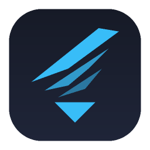
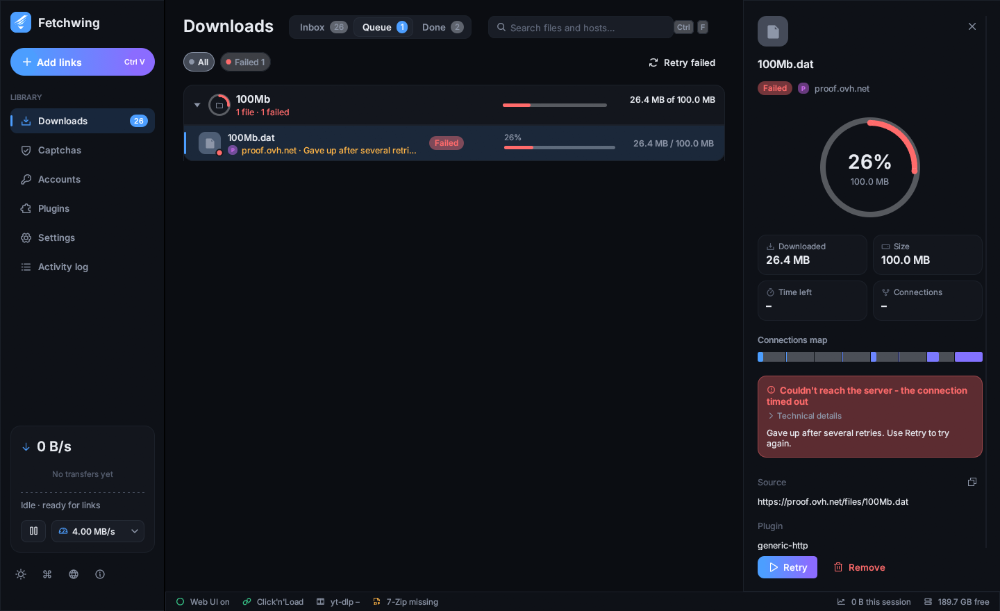
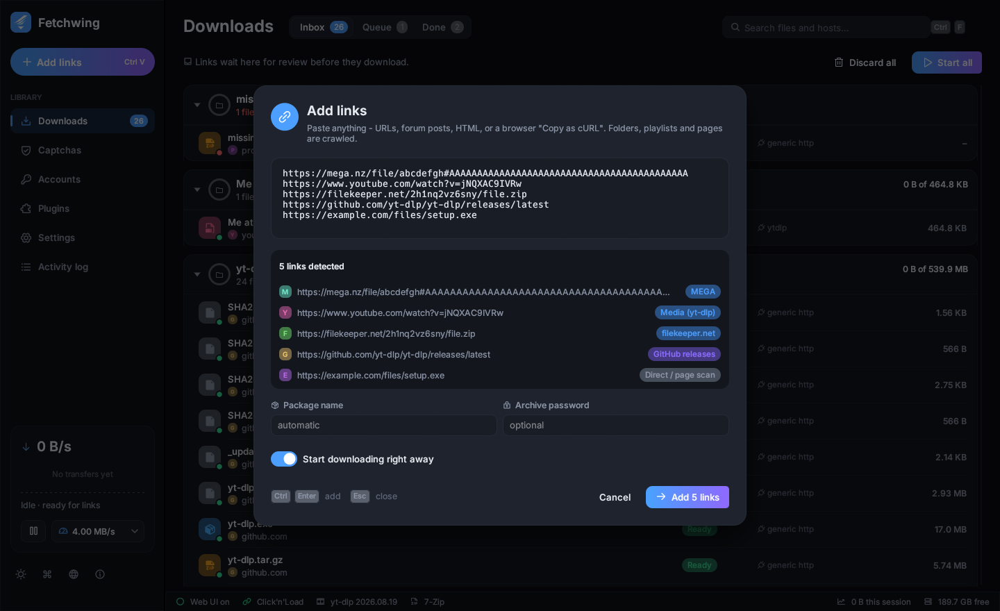
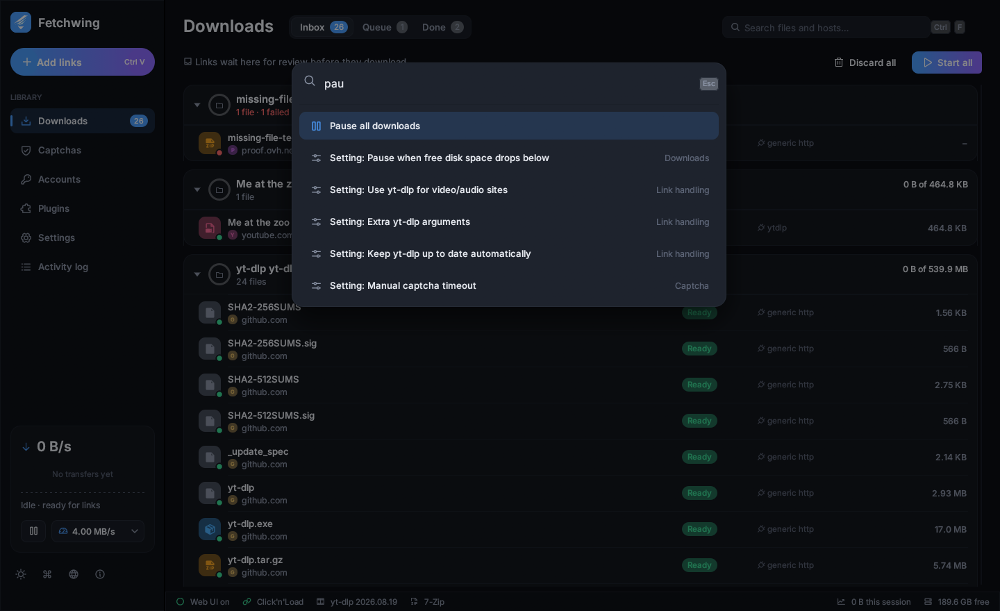
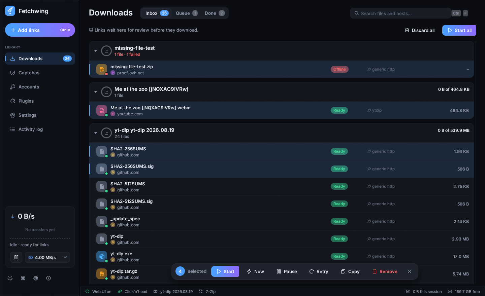
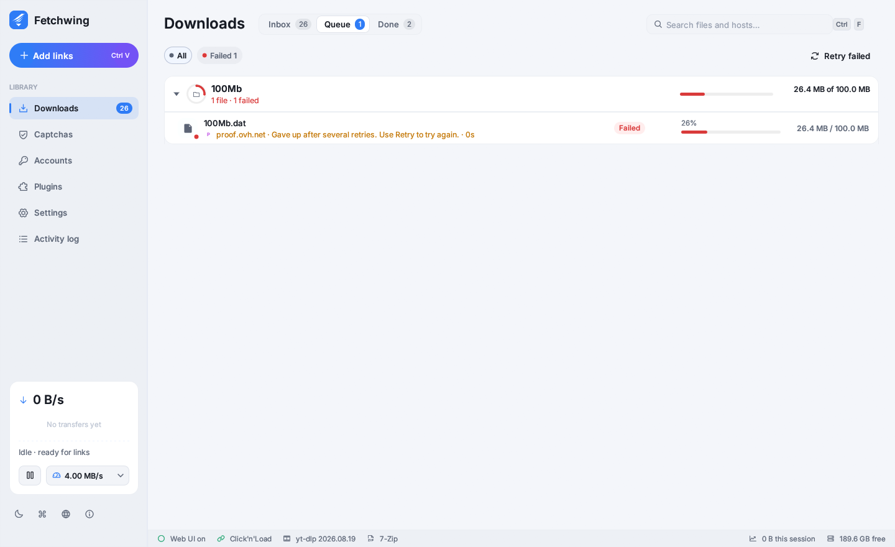

<div align="center">



# Fetchwing

**The download manager your download manager wanted to grow up to be.**

A fast, native, ad-free download manager written in Rust.
It's the spiritual evolution of JDownloader: same superpowers, none of the baggage.

[](LICENSE)


[**Download**](https://github.com/Shalashanka/fetchwing/releases/latest) ·
[Features](#features) ·
[Using it](#using-it) ·
[Building](#building-from-source) ·
[FAQ](#faq)



</div>

---

## Why does this exist?

For roughly fifteen years, one Java app has been the answer to "how do I download this from a
file host?". It's very good at the job, and it has collected some baggage along the way:

- a JVM that wants a good chunk of your RAM before it shows you a window,
- an installer that offers you things you didn't ask for,
- captcha dialogs that pop up over the game you're playing,
- a "LinkGrabber" tab people only find on their third day,
- and a settings tree you can get lost in.

Fetchwing keeps the superpowers (plugins, crawling, debrid, Click'n'Load, auto-extraction) and
rebuilds everything else from scratch as one small native binary. Think of it as the same
idea after a long holiday: rested, lighter, and dressed better.

> **Not affiliated.** Fetchwing is an independent, unofficial project. It has no connection to
> AppWork GmbH or the JDownloader project, and they don't endorse it. "JDownloader" is a
> trademark of its owner. We just really like what it does.

## Features

| | |
|---|---|
| ⚡ **Fast engine** | Segmented, resumable downloads with work-stealing connections: a free connection takes over half of the largest remaining segment. Downloads survive restarts and crashes. Sparse files, so a 100 GB download doesn't zero-fill your disk first. |
| 📋 **Paste anything** | Press **Ctrl+V** anywhere in the window. URLs are pulled out of plain text, HTML, forum posts, and even a browser's **"Copy as cURL"** (cookies and headers included). |
| 🧩 **471 plugins** | Pixeldrain, GoFile, MediaFire, Google Drive, Dropbox, MEGA (with in-app decryption), 1fichier, Internet Archive, GitHub releases, plus about 450 template-based XFS / YetiShare / KVS sites. |
| 🎬 **1,800+ media sites** | Through [yt-dlp](https://github.com/yt-dlp/yt-dlp). Fetchwing keeps its own copy up to date and retries Cloudflare-challenged pages with impersonation. |
| 🔑 **Debrid built in** | Add a Real-Debrid, AllDebrid, Premiumize or TorBox token once. Every hoster that service supports is then unlocked automatically. |
| 🛡️ **Captchas that wait their turn** | Captchas go into their own queue and never pop over your game. You can optionally hand them to 2Captcha, Anti-Captcha, CapSolver, CapMonster, or a solver you host yourself. |
| 📦 **Auto-extraction** | Uses 7-Zip, with password lists and passwords picked up from link pages. Extraction runs at low CPU priority, so your movie doesn't stutter. |
| ✅ **Integrity** | Checks MD5, SHA-1, SHA-256 or CRC32 whenever the host publishes one. |
| 🔗 **Click'n'Load v2** | Compatible with link protectors, without running the JavaScript they send you. |
| 🌐 **Headless & remote** | Built-in web UI plus a REST/SSE API, protected by a token. Runs on a NAS, a server or in Docker, with no cloud relay. |
| ⌨️ **Keyboard-first** | **Ctrl+K** command palette, **Ctrl+F** search, arrows / Space / Enter / Delete in the list, and **1 2 3** to switch Inbox / Queue / Done. |
| 🎨 **Looks the part** | Dark and light themes, smooth animations, and a UI drawn on the GPU at your monitor's refresh rate. |

<table>
<tr>
<td></td>
<td></td>
</tr>
<tr>
<td align="center"><sub>Paste a mess of links and see which plugin handles each one before you add it.</sub></td>
<td align="center"><sub>Ctrl+K: every command, setting and file, one keystroke away.</sub></td>
</tr>
<tr>
<td></td>
<td></td>
</tr>
<tr>
<td align="center"><sub>The Inbox: review links first, then act on many at once.</sub></td>
<td align="center"><sub>Light theme, for people who like light themes.</sub></td>
</tr>
</table>

## Install

Grab the latest build from **[Releases](https://github.com/Shalashanka/fetchwing/releases/latest)**.

**Windows 10/11**
- `Fetchwing-Setup-x.y.z-x64.exe` installs per user with no admin prompt. It adds Start-menu
  shortcuts and, optionally, PATH, desktop and autostart entries.
- `fetchwing-x.y.z-windows-x64-portable.exe` is the same app with no installer. Run it from
  anywhere, including a USB stick.

**Linux (x86_64, glibc 2.28+)**
```bash
tar xzf fetchwing-*-x86_64-linux.tar.gz
cd fetchwing-*-x86_64-linux && ./install.sh     # installs to ~/.local/bin and adds a desktop entry
```
On a server, run `./fetchwing --headless` instead.

**Optional helpers**
- **7-Zip** for extraction (`7zip` / `p7zip-full` on Linux).
- **ffmpeg** for merging video and audio streams. yt-dlp needs it for most video sites.

## Using it

| You want to… | Do this |
|---|---|
| Add links | Copy them anywhere, then press **Ctrl+V** in Fetchwing. Or click **Add links**. |
| Grab a link a site only reveals when you click | Open DevTools → Network, click the site's download button, right-click the request → **Copy as cURL**, then press Ctrl+V in Fetchwing. Cookies, Referer and User-Agent are replayed. |
| Review links before downloading | Turn on "Review in the Inbox first". Links wait in the **Inbox** until you press **Start**. |
| Unlock premium-only hosters | **Accounts** → connect your debrid service with its API token. |
| Download on a NAS or server | Run `fetchwing --headless --bind 0.0.0.0`, open `http://server:7979/`, and paste the token printed in the console. |
| Script it | `fetchwing add "https://…"`, `fetchwing ls`, `fetchwing pause`, `fetchwing limit 2` (MB/s). |
| Add a site without writing code | Drop a JSON definition into the plugin folder. See [docs/plugin-authoring.md](docs/plugin-authoring.md). |
| Throttle during work hours | Settings → Schedule: `Mon-Fri 08:00-18:00 2MB` |
| Pass options to yt-dlp | Settings → Link handling → **Extra yt-dlp arguments**, for example `--cookies-from-browser firefox`. |

Your data (download list, settings, encrypted accounts and logs) is stored in:
`%LOCALAPPDATA%\Fetchwing` on Windows, `~/.local/share/fetchwing` on Linux, and
`~/Library/Application Support/Fetchwing` on macOS.

## Building from source

You need a recent stable Rust toolchain.

```bash
cargo build --release          # native build (Windows and Linux are tested; macOS should build)
cargo test --release           # engine, crawler, crypto and packagizer tests
```

Release packaging (optional):

```bash
cargo zigbuild --release --target x86_64-unknown-linux-gnu.2.28   # Linux binary from any OS (needs zig + cargo-zigbuild)
ISCC packaging/windows/fetchwing.iss                              # Windows installer (Inno Setup 6)
bash packaging/build-release.sh                                   # all of the above, into dist/
```

### Project layout

```
src/
  engine.rs        segmented, resumable HTTP download engine
  core.rs          queue, scheduling, accounts, post-processing
  crawler.rs       link extraction, "Copy as cURL" parsing, packaging
  plugins/         hosters, crawlers, debrid, yt-dlp and template engines
  captcha.rs       captcha queue and solver integrations
  cnl.rs           Click'n'Load v2 receiver
  postprocess.rs   checksums and archive extraction
  api.rs, cli.rs   REST + SSE API, web UI and command line
  gui/             native desktop UI (egui)
assets/            icon, fonts, web UI, template site definitions
packaging/         Inno Setup script and Linux install files
```

## FAQ

**Is this JDownloader?**
No. It's an independent project that shares the goal and openly admires the original. Think of
it as a spiritual successor rather than a fork.

**Does it need Java?**
No. Fetchwing is a single native executable of about 15 MB.

**Will it show me ads or install a toolbar?**
No. There's no telemetry and no account, and it never phones home. The only thing it downloads
on its own is yt-dlp, from yt-dlp's official GitHub releases.

**A site I use isn't supported.**
Many sites are covered by simple JSON templates; see
[docs/plugin-authoring.md](docs/plugin-authoring.md). You're also welcome to open an issue or a
pull request.

**Can it bypass paywalls or DRM?**
No, and it won't. Fetchwing downloads files you're allowed to access.

## Contributing

Bug reports, plugin definitions and pull requests are all welcome. Before submitting code,
please run `cargo test --release`.

## Responsible use

Respect the terms of service of the sites you download from and the copyright law where you
live. Fetchwing is a tool. What you fetch with it is your responsibility.

## License

Fetchwing is free software, released under the **[GNU General Public License v3.0 or later](LICENSE)**.
The template site definitions are derived from the GPL-licensed JDownloader 2 plugin
collection. The Inter typeface is used under the [SIL Open Font License](assets/fonts/Inter-OFL.txt),
and icons come from [Phosphor](https://phosphoricons.com) (MIT).

<div align="center"><sub>Made with Rust, coffee, and a deep personal grudge against pop-up captchas.</sub></div>
